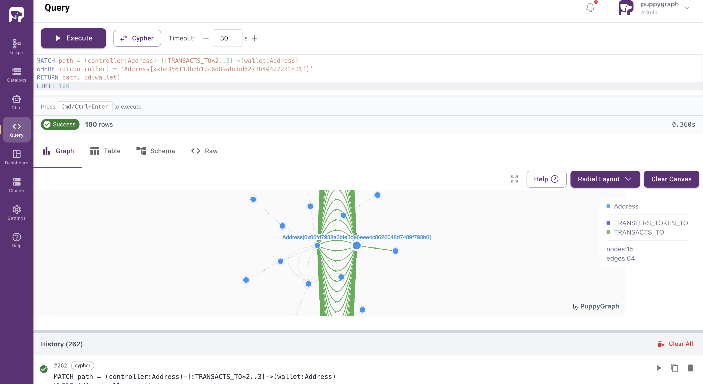
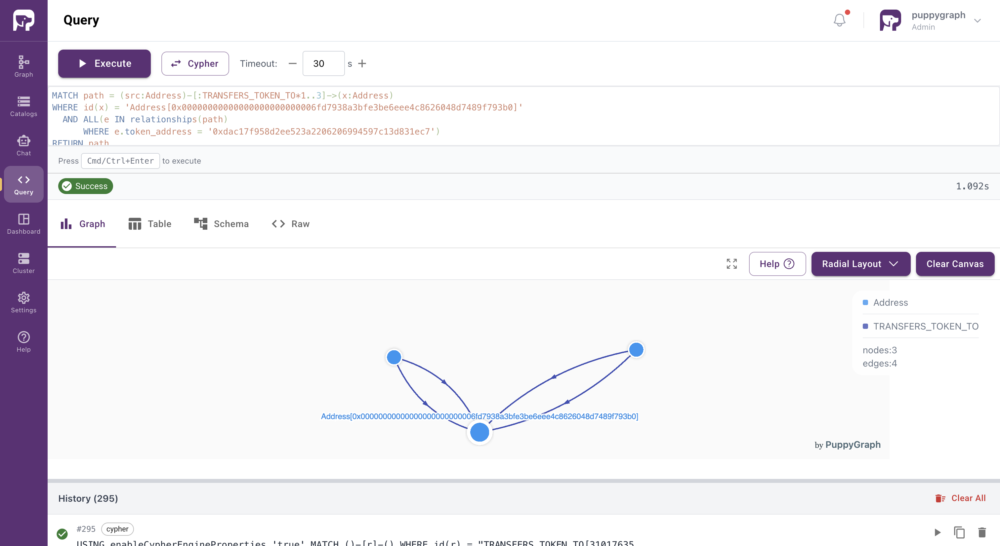
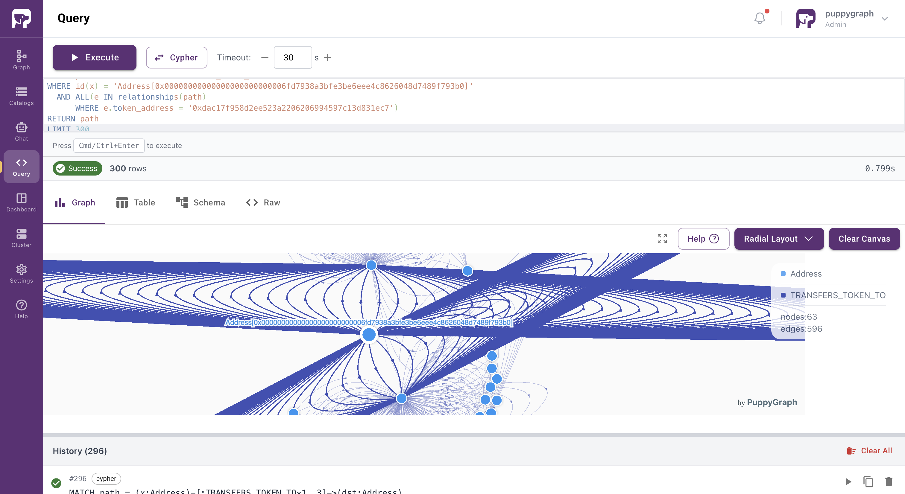

# Ethereum Blockchain Graph Demo

## Summary
This demo shows how to query the [AWS Public Blockchain Dataset](https://registry.opendata.aws/aws-public-blockchain/) as a graph using PuppyGraph. Starting from a [known phishing wallet](https://etherscan.io/address/0xbe356f13b7b1bc6d89abcbd6272b40427231411f) flagged by HashDit, we trace ETH gas-funding infrastructure and USDT flows through a coordinated collection network to its final destinations.

AWS Public Blockchain Data was accessed on 2026-05-20 from https://registry.opendata.aws/aws-public-blockchain.

## Prerequisites
- Docker
- Python 3

Everything runs locally with Docker Compose. The blockchain data is downloaded anonymously from the public bucket; no AWS account is needed.

## Data Preparation

### 1. Install dependencies
```bash
python3 -m venv .venv
source .venv/bin/activate
pip install -r requirements.txt
```

### 2. Download the blockchain data
Downloads the `transactions` and `token_transfers` parquet files for one day (about 1.2 GB) into `parquet_data/`:
```bash
python get_data.py
```
Set `DATE_START` and `DATE_END` (ISO dates) to fetch a different range.

### 3. Start the stack
Starts the object store, the Iceberg REST catalog, Spark and PuppyGraph:
```bash
docker compose up -d
```

### 4. Load the parquet into Iceberg tables
Creates the `eth_iceberg` namespace and the two tables:
```bash
docker exec spark-iceberg spark-sql --driver-memory 4g -f /sql/load.sql
```

## Modeling the Graph
1. Log into the PuppyGraph Web UI at http://localhost:8081 with the following credentials:
   - Username: `puppygraph`
   - Password: `puppygraph123`

2. Upload the schema:
   - Click **Upload Schema**, select `schema.json` and click **Upload**.
   - You can also upload it from the terminal:
     ```bash
     curl -XPOST -H "content-type: application/json" \
       --data-binary @./schema.json \
       --user "puppygraph:puppygraph123" \
       localhost:8081/schema
     ```

## Querying the Graph

Navigate to the Query panel on the left side. The Graph Query tab offers an interactive environment for querying the graph using Gremlin and Cypher. After each query, remember to clear the graph panel before executing the next query. You can do this by clicking the **Clear Canvas** button in the top-right corner.

Example Queries:

1. Who is the controller funding, and at what scale?
```cypher
MATCH path = (controller:Address)-[:TRANSACTS_TO*2..3]->(wallet:Address)
WHERE id(controller) = 'Address[0xbe356f13b7b1bc6d89abcbd6272b40427231411f]'
RETURN path, id(wallet)
LIMIT 100
```


2. Which wallets are feeding the collection address?
```cypher
MATCH path = (src:Address)-[:TRANSFERS_TOKEN_TO*1..3]->(x:Address)
WHERE id(x) = 'Address[0x00000000000000000000000006fd7938a3bfe3be6eee4c8626048d7489f793b0]'
  AND ALL(e IN relationships(path)
      WHERE e.token_address = '0xdac17f958d2ee523a2206206994597c13d831ec7')
RETURN path
LIMIT 300
```


3. Where does the USDT flow after leaving the collection point?
```cypher
MATCH path = (x:Address)-[:TRANSFERS_TOKEN_TO*1..3]->(dst:Address)
WHERE id(x) = 'Address[0x00000000000000000000000006fd7938a3bfe3be6eee4c8626048d7489f793b0]'
  AND ALL(e IN relationships(path)
      WHERE e.token_address = '0xdac17f958d2ee523a2206206994597c13d831ec7')
RETURN path
LIMIT 300
```


## Cleanup and Teardown
- To stop and remove the containers:
```bash
docker compose down
```
